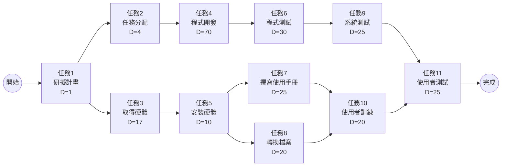
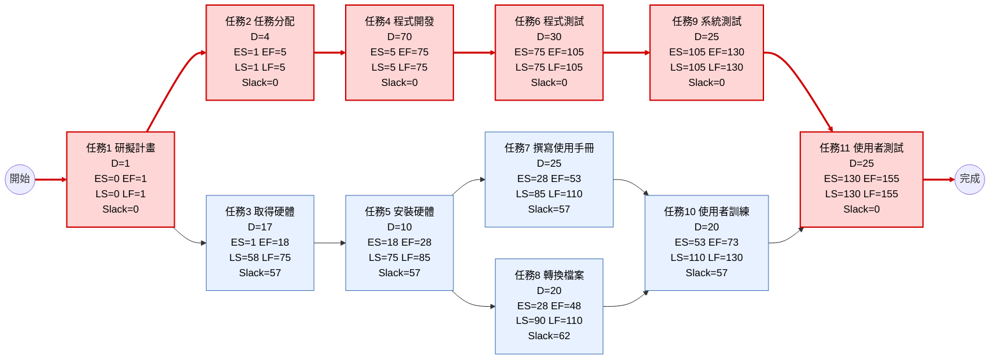
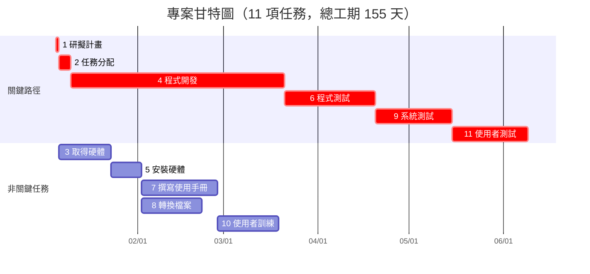

# 個人作業 2：工作分解結構（圖 3-27）— PERT/CPM、甘特圖與關鍵路徑

## 一、任務清單（圖 3-27）

| 任務 | 說明 | 需時（天） | 前置任務 |
|:---:|---|:---:|:---:|
| 1 | 研擬計畫 | 1 | - |
| 2 | 任務分配 | 4 | 1 |
| 3 | 取得硬體 | 17 | 1 |
| 4 | 程式開發 | 70 | 2 |
| 5 | 安裝硬體 | 10 | 3 |
| 6 | 程式測試 | 30 | 4 |
| 7 | 撰寫使用手冊 | 25 | 5 |
| 8 | 轉換檔案 | 20 | 5 |
| 9 | 系統測試 | 25 | 6 |
| 10 | 使用者訓練 | 20 | 7, 8 |
| 11 | 使用者測試 | 25 | 9, 10 |

---

## 二、步驟一：顯示任務及任務模式（PERT/CPM 網路圖）

此步驟只標示各任務、需時（D）及任務之間的前後依存關係，尚未填入時間。



---

## 三、步驟二：輸入開始及結束時間

### 3.1 時間計算

- **順推（Forward Pass）**：ES = 所有前置任務 EF 的最大值；EF = ES + D
- **逆推（Backward Pass）**：LF = 所有後續任務 LS 的最小值；LS = LF − D
- **寬裕時間（Slack）** = LS − ES = LF − EF；Slack = 0 者為關鍵任務

專案起點設為第 0 天，時間單位為「天」。

| 任務 | 說明 | D | 前置 | ES（最早開始） | EF（最早結束） | LS（最晚開始） | LF（最晚結束） | Slack | 關鍵？ |
|:---:|---|:---:|:---:|:---:|:---:|:---:|:---:|:---:|:---:|
| 1 | 研擬計畫 | 1 | - | 0 | 1 | 0 | 1 | 0 | True |
| 2 | 任務分配 | 4 | 1 | 1 | 5 | 1 | 5 | 0 | True |
| 3 | 取得硬體 | 17 | 1 | 1 | 18 | 58 | 75 | 57 | False |
| 4 | 程式開發 | 70 | 2 | 5 | 75 | 5 | 75 | 0 | True |
| 5 | 安裝硬體 | 10 | 3 | 18 | 28 | 75 | 85 | 57 | False |
| 6 | 程式測試 | 30 | 4 | 75 | 105 | 75 | 105 | 0 | True |
| 7 | 撰寫使用手冊 | 25 | 5 | 28 | 53 | 85 | 110 | 57 | False |
| 8 | 轉換檔案 | 20 | 5 | 28 | 48 | 90 | 110 | 62 | False |
| 9 | 系統測試 | 25 | 6 | 105 | 130 | 105 | 130 | 0 | True |
| 10 | 使用者訓練 | 20 | 7, 8 | 53 | 73 | 110 | 130 | 57 | False |
| 11 | 使用者測試 | 25 | 9, 10 | 130 | 155 | 130 | 155 | 0 | True |

**計算說明（重點）**

- 任務 10 的 ES = max(EF₇, EF₈) = max(53, 48) = 53
- 任務 11 的 ES = max(EF₉, EF₁₀) = max(130, 73) = 130
- 任務 5 的 LF = min(LS₇, LS₈) = min(85, 90) = 85
- 任務 1 的 LF = min(LS₂, LS₃) = min(1, 58) = 1

### 3.2 PERT/CPM 網路圖（含時間，紅色為關鍵路徑）

節點格式：`ES | EF` 為最早開始／結束，`LS | LF` 為最晚開始／結束。



### 3.3 甘特圖

假設專案開始日為 **2026-01-05**（第 0 天），以日曆天計算（日期可依實際開工日調整）。每項任務依其前置任務完成後立即開始（最早開始時間），紅色為關鍵任務。



### 3.4 各任務開始及結束時間

| 任務 | 說明 | 開始（第 N 天） | 結束（第 N 天） | 開始日期 | 結束日期 |
|:---:|---|:---:|:---:|:---:|:---:|
| 1 | 研擬計畫 | 0 | 1 | 2026-01-05 | 2026-01-06 |
| 2 | 任務分配 | 1 | 5 | 2026-01-06 | 2026-01-10 |
| 3 | 取得硬體 | 1 | 18 | 2026-01-06 | 2026-01-23 |
| 4 | 程式開發 | 5 | 75 | 2026-01-10 | 2026-03-21 |
| 5 | 安裝硬體 | 18 | 28 | 2026-01-23 | 2026-02-02 |
| 6 | 程式測試 | 75 | 105 | 2026-03-21 | 2026-04-20 |
| 7 | 撰寫使用手冊 | 28 | 53 | 2026-02-02 | 2026-02-27 |
| 8 | 轉換檔案 | 28 | 48 | 2026-02-02 | 2026-02-22 |
| 9 | 系統測試 | 105 | 130 | 2026-04-20 | 2026-05-15 |
| 10 | 使用者訓練 | 53 | 73 | 2026-02-27 | 2026-03-19 |
| 11 | 使用者測試 | 130 | 155 | 2026-05-15 | 2026-06-09 |

> 註：「結束」為該任務完成的時間點（= 開始 + 需時），與甘特圖條狀圖的右端一致。

---

## 四、關鍵路徑（Critical Path）

**關鍵路徑：1 → 2 → 4 → 6 → 9 → 11**

```
研擬計畫(1) → 任務分配(4) → 程式開發(70) → 程式測試(30) → 系統測試(25) → 使用者測試(25)
```

總工期 = 1 + 4 + 70 + 30 + 25 + 25 = **155 天**

### 所有路徑比較

| 路徑 | 任務順序 | 總工期（天） |
|---|---|:---:|
| **A（關鍵）** | 1 → 2 → 4 → 6 → 9 → 11 | **155** |
| B | 1 → 3 → 5 → 7 → 10 → 11 | 1+17+10+25+20+25 = 98 |
| C | 1 → 3 → 5 → 8 → 10 → 11 | 1+17+10+20+20+25 = 93 |

路徑 A 最長，決定了整個專案的最短完成時間。關鍵任務（1、2、4、6、9、11）的 Slack 皆為 0，任何一項延遲都會使整個專案延遲；非關鍵任務 3、5、7、8、10 分別有 57、57、57、62、57 天的寬裕時間，可在不影響總工期的情況下彈性安排。
